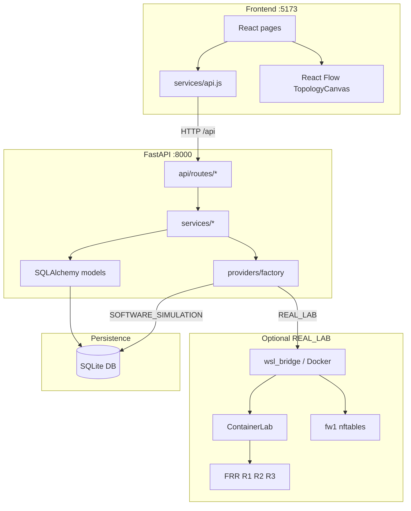
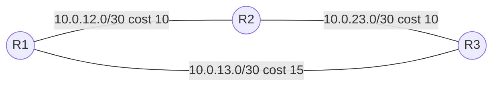
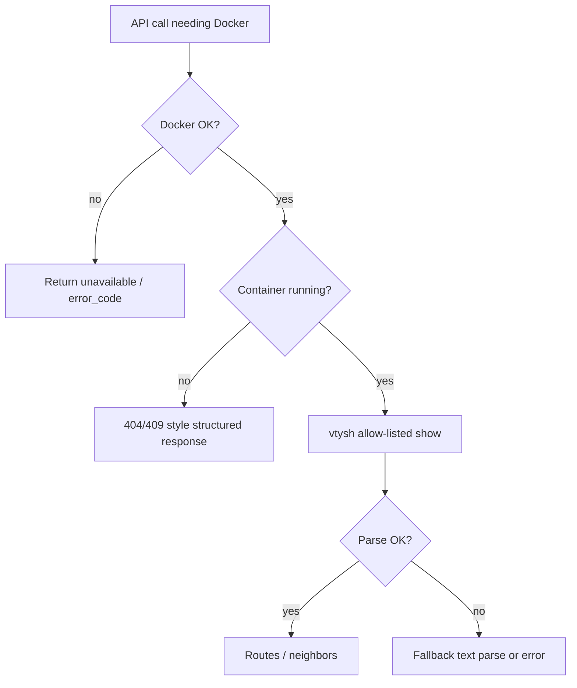

# RouteWise — Technical Architecture Walkthrough

This document explains how data actually moves through the system, layer by layer, based on the current source tree.

---

## 1. Big picture



**Invariant:** the browser never calls Docker. Only the backend does, and only with allow-listed argv.

---

## 2. Startup sequence

1. `uvicorn app.main:app` loads FastAPI app.
2. `on_startup` → `init_db()` creates tables.
3. `NetworkService.seed_default_triangle()` inserts **"RouteWise Triangle Lab"** if missing.
4. Vite serves React; `useNetworkLab` loads overview + default network + lab/infra status.

---

## 3. End-to-end journeys

### 3.1 Explore a route (software)

```
User clicks Path Explorer → selects R1→R3 → "Trace path"
    ↓
api.getPaths(networkId, "R1", "R3")
    ↓
GET /api/networks/{id}/paths
    ↓
NetworkService.get_network → routers + links from SQLite
    ↓
PathEngine.all_simple_paths / lowest_cost_path
    ↓
PathExploreResponse JSON (data_source=software_simulation)
    ↓
UI highlights protocol_selected hops on React Flow; lists candidates
```

**Responsible files**

- Frontend: `PathOptimizePages.jsx`, `api.js`, `TopologyCanvas.jsx`
- Backend: `api/routes/analysis.py`, `path_engine.py`, `schemas/network.py`

### 3.2 Optimization recommendation

Same as paths until candidates exist, then:

```
optimizer.recommend(...)
    ↓
score_paths → normalize L,P,H,C → S = 0.35L+0.25P+0.20H+0.20C
    ↓
OptimizeResponse with recommended_path, protocol_selected_path, explanation
```

**Important:** this does **not** rewrite FRR or OSPF. It is an advisory software score.

### 3.3 Disable a link (software simulation)

```
Simulation Lab → Disable R1-R3
    ↓
POST /api/networks/{id}/simulate/links/{link_id}/disable
    ↓
SimulationService.set_link_state(enabled=False)
    ↓
UPDATE links; INSERT events; commit
    ↓
Frontend reloads network + GET paths R1→R3
    ↓
Canvas shows alternate path R1→R2→R3
```

### 3.4 Read live OSPF neighbors (real lab)

```
Routing / tooling → getOspfNeighbors("R1")
    ↓
GET /api/routers/R1/ospf-neighbors
    ↓
RoutingService validates router id ∈ {R1,R2,R3}
    ↓
DockerService.inspect_container_state("clab-routewise-r1")
    ↓
If running: docker exec … vtysh -c "show ip ospf neighbor json" (allow-listed)
    ↓
Parse JSON (FRR 10.x nested neighbors) or text fallback
    ↓
OspfNeighborsResponse to client
```

If Docker/lab down → structured `available=false` + `error_code` (503/409/404 mapping).

### 3.5 Deploy lab

```
Settings → Deploy
    ↓
POST /api/lab/deploy
    ↓
ContainerLabProvider.deploy
    ↓
wsl_bridge.run_argv([clab, deploy, -t, lab/routewise.clab.yml])
    ↓
probe containers r1/r2/r3 running → active_mode=REAL_LAB
```

### 3.6 Firewall test vs apply

**Test (always software evaluator)**

```
POST …/firewall/test → first matching enabled rule by priority → allow/deny + hit_count++
```

**Apply (REAL_LAB only)**

```
POST …/firewall/apply → docker exec clab-routewise-fw1 nft …
```

Does not touch Windows Defender Firewall.

---

## 4. Layer details

### 4.1 React

- SPA with React Router paths defined in `App.jsx`.
- Shared state from `useNetworkLab` avoids each page re-seeding blindly.
- Presentational pages call `api.*` then set local state.

### 4.2 React Flow

- `TopologyCanvas` maps routers → nodes, links → edges.
- `highlightPath` emphasizes hop sequence from path APIs.
- Visual only; graph math lives in the backend `PathEngine`.

### 4.3 FastAPI

- Thin route modules; business logic in services.
- Pydantic response models enforce API shape.
- CORS middleware; validation and generic 500 handlers in `main.py`.

### 4.4 Pydantic

- Request/response schemas in `app/schemas/network.py`, `router.py`, `firewall.py`.
- Keeps API contracts explicit for OpenAPI at `/docs`.

### 4.5 SQLAlchemy + SQLite

- ORM models in `db/models.py`.
- Session dependency `get_db`.
- Cascade delete from network → routers/links/events.

### 4.6 NetworkService

- Seed, CRUD-ish network operations, static routes, events.
- Single source for persisted triangle matching lab addressing.

### 4.7 PathEngine

- Builds undirected adjacency excluding down/disabled links and down routers.
- DFS for simple paths; BFS-style reachability helper.
- Aggregates cost, latency, average loss, hop list.

### 4.8 Optimization engine

- Deterministic, explainable, no ML.
- Relative normalization among **current** available candidates only.

### 4.9 SimulationService

- Mutates link/router status flags.
- Software ping/traceroute follow lowest-cost available path and label themselves as simulation.

### 4.10 Providers

| Class | Role |
|-------|------|
| `SoftwareSimulationProvider` | Always-available status for soft mode |
| `ContainerLabProvider` | deploy/destroy/status against real lab |
| `factory.probe_infrastructure` | Combined payload for Settings/Sidebar |

### 4.11 DockerService + wsl_bridge

- Fixed argv templates only.
- Prefer Windows Docker; fall back to WSL docker when named pipe fails.
- Timeouts and classified error kinds (`CLI_MISSING`, `DAEMON_UNAVAILABLE`, …).

### 4.12 ContainerLab + FRR

- YAML defines nodes/links; binds mount `lab/configs/rN` into `/etc/frr`.
- FRR runs zebra + ospfd (+ ripd/staticd per `daemons`).
- App inspects with vtysh show commands — it does not implement OSPF itself.

### 4.13 FirewallService

- Policy in SQLite.
- Software first-match evaluation for demos.
- Optional nft apply on `fw1` only.

---

## 5. Software simulation vs actual network execution

| Operation | Software simulation | Actual network (FRR) |
|-----------|---------------------|----------------------|
| Path list / optimize | SQLite graph + Python | Not used for scoring |
| Disable link (UI) | Flip DB flags | Does not shut container iface |
| Ping/traceroute APIs | Graph latency estimate | Real ICMP only if you exec inside containers |
| Routing table view | N/A (static routes table is DB) | `show ip route` via API when lab up |
| OSPF neighbors | N/A | `show ip ospf neighbor` |
| Failover teaching | Immediate DB path change | Real OSPF reconvergence (verified manually in E2E) |
| Firewall test | Policy engine | — |
| Firewall apply | No-op unless REAL_LAB | nft on `fw1` |

**How to speak this in viva:**  
“Our dashboard’s Path Explorer and Optimization run on a software graph that mirrors the lab addressing. When ContainerLab is up, Routing Manager / router APIs read live FRR state. We never pretend the weighted score is computed by OSPF.”

---

## 6. Graph model used by PathEngine



- **Nodes:** routers  
- **Edges:** bidirectional links when enabled and up  
- **Edge weights for “protocol-selected”:** `Link.cost` sum  
- **Other metrics:** latency sum, mean packet loss, hop count  

---

## 7. API surface map (practical)

| Area | Endpoints |
|------|-----------|
| Health | `GET /api/health` |
| Dashboard | `GET /api/dashboard/overview` |
| Networks | `GET/POST /api/networks`, `GET/DELETE /api/networks/{id}`, routers/links/events/static-routes |
| Analysis | `…/paths`, `…/optimize`, `…/simulate/...`, `…/diagnostics/ping|traceroute` |
| Lab | `…/infrastructure`, `…/protocols`, `…/inspect`, `…/deploy|destroy|restart` |
| FRR inventory | `GET /api/lab/status`, `/api/routers`, `/api/topology`, `/api/routers/{id}/routes`, `/ospf-neighbors` |
| Firewall | `…/firewall/status|rules|test|apply` |

OpenAPI: `http://127.0.0.1:8000/docs`

---

## 8. Frontend route map

| Path | Page | Primary data |
|------|------|--------------|
| `/` | Dashboard | overview |
| `/topology` | TopologyPage | network |
| `/routing` | RoutingPage | static routes + `/api/lab/protocols` |
| `/paths` | PathExplorerPage | paths API |
| `/optimize` | OptimizationPage | optimize API |
| `/simulation` | SimulationPage | simulate + paths |
| `/firewall` | FirewallPage | firewall APIs |
| `/analytics` | AnalyticsPage | synthetic UI |
| `/events` | EventsPage | events API |
| `/reports` | ReportsPage | overview/network |
| `/settings` | SettingsPage | infrastructure + lifecycle |

---

## 9. Failure and degradation behavior



Software features continue even when lab is `UNAVAILABLE`. Sidebar still shows `SOFTWARE_SIMULATION`.

---

## 10. What each major package “owns”

| Package | Ownership boundary |
|---------|-------------------|
| `frontend/src/pages` | UX workflows |
| `frontend/src/services/api.js` | HTTP contract |
| `backend/app/api/routes` | HTTP ↔ service adapters |
| `backend/app/services/*` | Domain logic |
| `backend/app/db` | Persistence |
| `backend/app/services/providers` | Mode selection / lab lifecycle |
| `lab/` | Real topology + FRR configs |
| `scripts/` | Dev/lab helper scripts |
| `backend/tests` | Regression with mocks |
